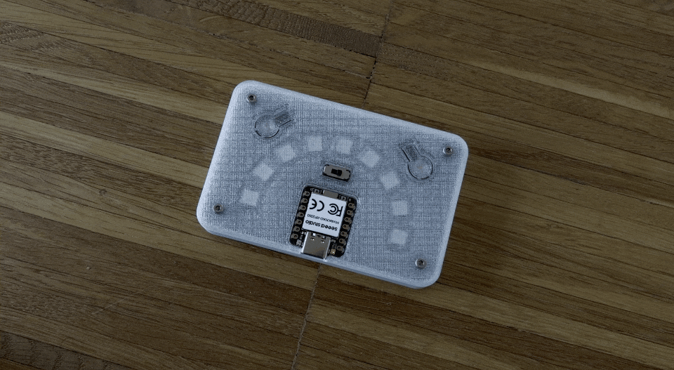
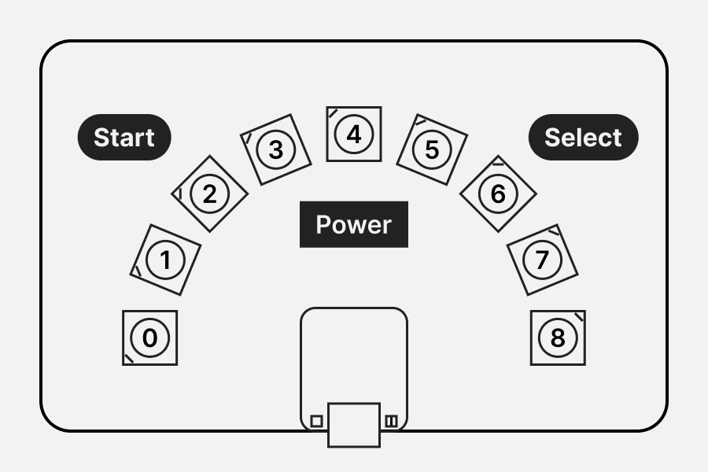
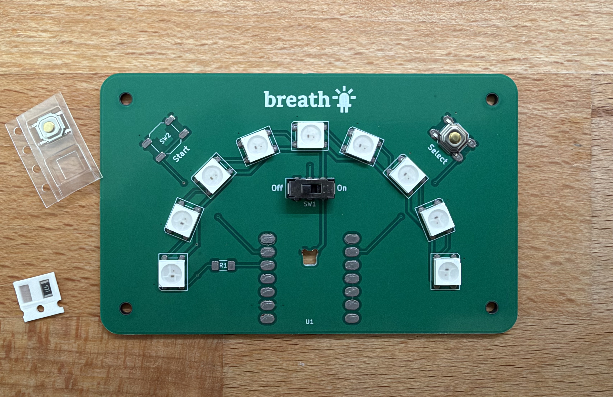
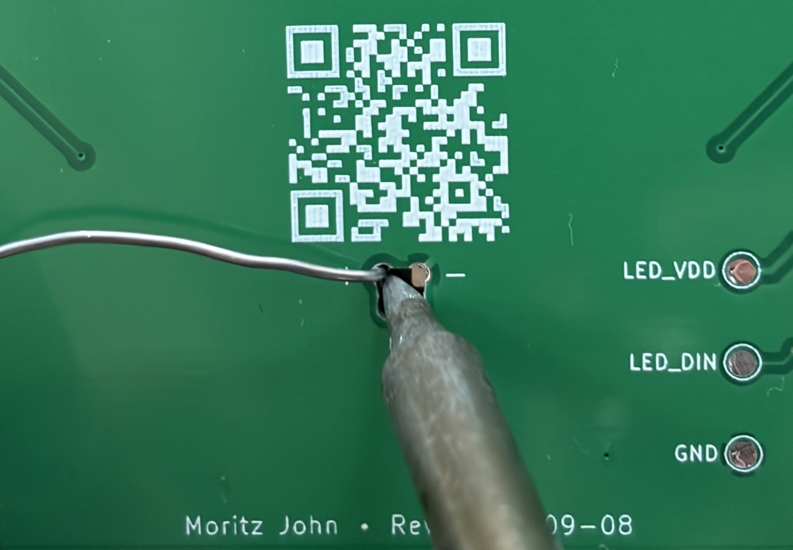
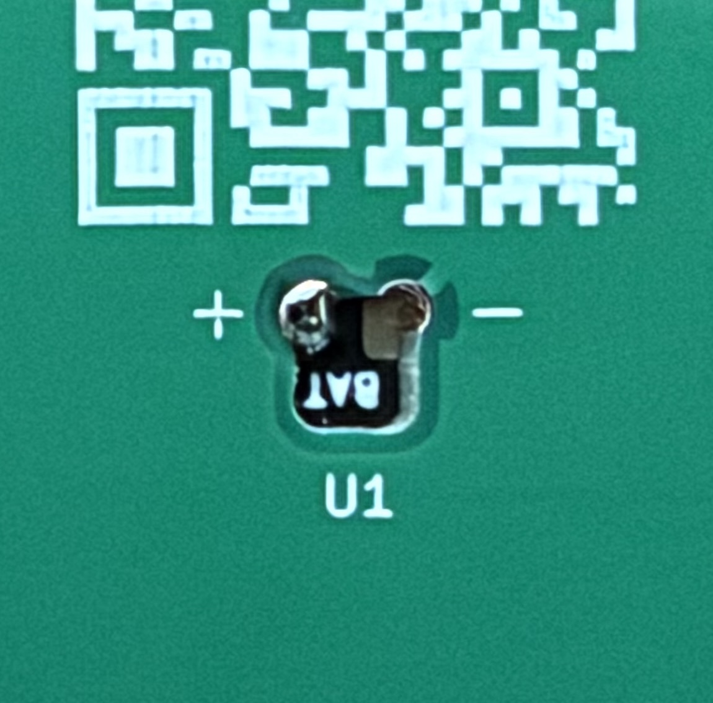
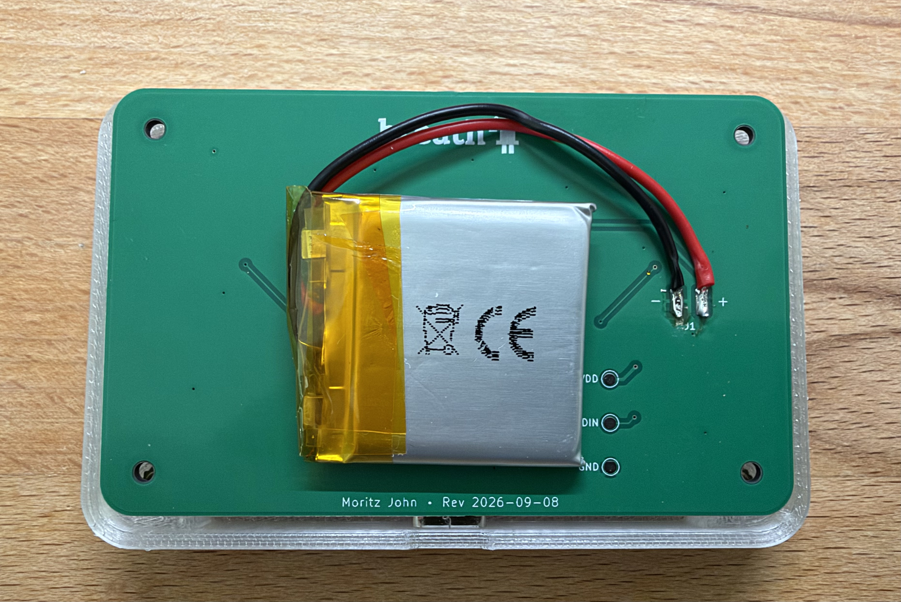
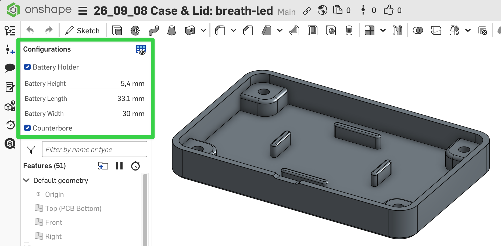
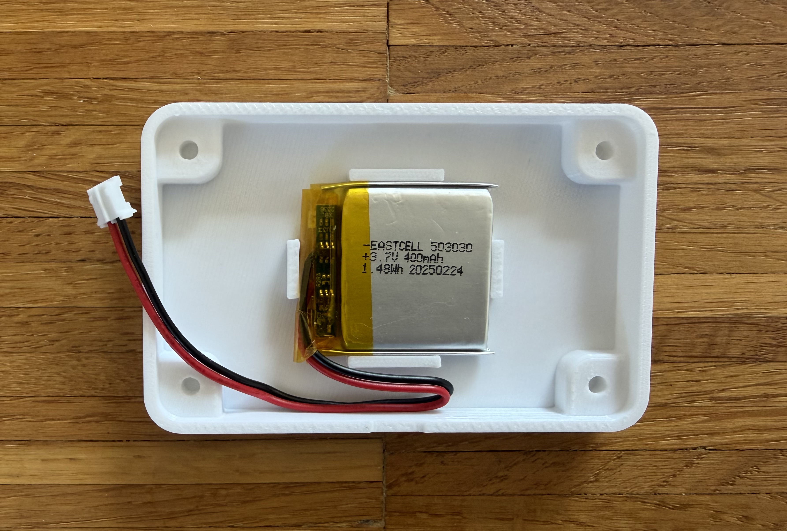
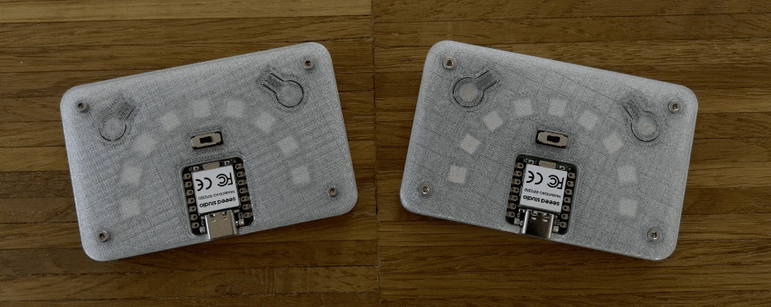
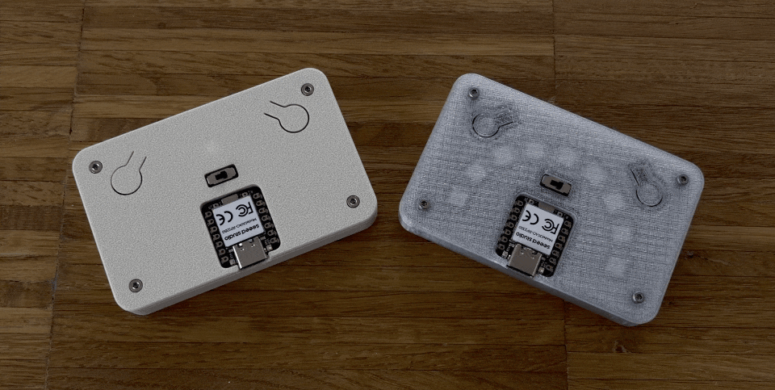

# breath-LED

<p align="center">
  <br>
  <small><i>The device running a "4-7-8" breathing exercise.</i></small>
</p>

A small, portable and dedicated device for breathwork exercises.

## Features

- Save up to 9 different breathwork exercises
- Colors and LED brightness are adjustable
- Battery indicator
- Easy to use: 1x On/Off switch | 2x buttons

**Jump to:** [Usage Guide](#usage-guide) | [Build Guide](#build-guide) | [Firmware](#firmware) | [Showcase](#showcase)

---

## Usage Guide

<p align="center">
  
</p>

1. Turn the device on by moving the **[Power]** switch to the right.
2. Press **[Select]** repeatedly to cycle through exercises; the lit LED (0–8) shows the currently selected one.
3. Start or stop the exercise by pressing the **[Start]** button.

When no exercise is running, press and hold **[Select]** to display the current battery level. More lit LEDs = higher battery level.

> [!NOTE]
> **Charging the device:** Set the **[Power]** switch to "On" before plugging in USB-C. The XIAO's charge LED blinks while charging and stops blinking once fully charged. Don't let the battery level drop below two lit LEDs!

Default exercises:

| LED Index | Exercise Name | Inhale | Hold | Exhale | Hold | Repeats |
| --------- | ------------- | -----: | ---: | -----: | ---: | ------: |
| 0         | 4-7-8         |    4 s |  7 s |    8 s |    — |       8 |
| 2         | Rectangle     |    6 s |  3 s |    6 s |  3 s |       8 |
| 4         | Coherent      |    5 s |    — |    5 s |    — |       8 |
| 6         | Box           |    4 s |  4 s |    4 s |  4 s |       8 |
| 8         | 1:2 Ratio     |    4 s |    — |    8 s |    — |       8 |

---

## Build Guide

### PCB

[Link to GERBER files](/hardware/kicad/jlcpcb/production_files/GERBER-breath-led.zip)

#### Part List for PCB

| Reference | Description     | Amount | Value/MPN            | Sources                                                   |
| --------- | --------------- | -----: | -------------------- | --------------------------------------------------------- |
| U1        | Microcontroller |     1x | XIAO RP2350          | [Seeed Studio][RP2350-seeed]                              |
| D1-D9     | RGB LEDs        |     9x | WS2812B-V5/W **¹**   | [LCSC][WS2812B-lcsc] / [AliExpress][WS2812B-ali]          |
| SW1       | Power Switch    |     1x | C&K JS202011JCQN     | [DigiKey][JS202011JCQN-digikey] / [TME][JS202011JCQN-tme] |
| SW2-SW3   | Push Button     |     2x | ALPS SKQGAFE010      | [DigiKey][SKQGAFE010-digikey] / [TME][SKQGAFE010-tme]     |
| R1        | Resistor        |     1x | 470 Ω (1206 Package) | [DigiKey][R4701206-digikey] / [TME][R4701206-tme]         |

> **¹** V5 or newer is required (removes the need for an external decoupling capacitor); V6 is preferred as it officially supports a 3.3 V supply.

[RP2350-seeed]: https://www.seeedstudio.com/Seeed-XIAO-RP2350-p-5944.html
[WS2812B-lcsc]: https://www.lcsc.com/product-detail/C2874885.html
[WS2812B-ali]: https://de.aliexpress.com/item/1005010417596935.html
[JS202011JCQN-digikey]: https://www.digikey.de/en/products/detail/c-k/JS202011JCQN/6137630
[JS202011JCQN-tme]: https://www.tme.eu/en/details/js202011jcqn/slide-switches/c-k/
[SKQGAFE010-digikey]: https://www.digikey.com/en/products/detail/alps-alpine/SKQGAFE010/19529060
[SKQGAFE010-tme]: https://www.tme.eu/de/en/details/skqgafe010/microswitches-tact/alps/
[R4701206-digikey]: https://www.digikey.com/en/products/detail/yageo/RC1206JR-07470RL/729301
[R4701206-tme]: https://www.tme.eu/de/en/details/rc1206jr-07470r/smd-resistors/yageo/rc1206jr-07470rl/

#### Top Side

Solder the top side with a hot plate; hand-soldering WS2812B LEDs is hard.
Apply solder paste to all pads and place the components on your PCB. Make sure that the "◤" marking of the LEDs aligns with the silkscreen.

<p align="center">
  
</p>

#### Bottom Side

Solder the battery pads of the XIAO RP2350 to the open through-hole pads on the PCB. You only need to solder the positive (+) pad of U1. Apply flux to the pad of the microcontroller. Feed solder wire into the through-hole pad. Then use a narrow soldering iron tip (e.g. TS-D24 for a Pinecil/TS100) that fits sideways into the PCB cutout while sticking into the open through-hole pad. Wait until the solder wire melts.

<table>
  <tr>
    <td align="center" valign="top">
      
    </td>
    <td align="center" valign="top">
      
    </td>
  </tr>
</table>

Once it has cooled, check your work with a multimeter in continuity mode:

1. Turn the **[Power]** switch on.
2. Touch one probe to the **positive (+) pad of U1** and the other to the **positive (+) pad J1**. They should be connected.
3. Check between the **positive (+) pad of U1** and the **negative (-) pad of U1** to make sure the solder did not accidentally bridge the two. They must **not** be connected.

Then turn the **[Power]** switch off again and solder the battery to the dedicated battery pads on the left of the PCB.

> [!WARNING]
> Wire colors on LiPo batteries are not standardized. Before soldering, check the positive (+) and negative (−) wires with a multimeter and compare them to the polarity markings on the PCB.

<p align="center">
  
</p>

### Case & Lid

#### Part List for Case & Lid

| Amount | Description        | Type                        | Sources                        |
| ------ | ------------------ | --------------------------- | ------------------------------ |
| 4x     | Heat Set Insert    | M2x3                        | [CNC Kitchen][m2x3-cnckitchen] |
| 4x     | Screw              | M2x6 (*DIN 912 / ISO 4762*) | [Amazon DE][m2x6-amazon]       |
| 1x     | LiPo Battery **²** | e.g.: 400mAh 503030         | [Amazon DE][battery-amazon]    |
| 1x     | Lid & Case         | 3D printed                  |                                |

> **²** Make sure that the battery comes with necessary protection circuitry!

[m2x3-cnckitchen]: https://cnckitchen.store/products/heat-set-insert-m2-x-3-100-pieces
[m2x6-amazon]: https://www.amazon.de/dp/B00S2U8WOG
[battery-amazon]: https://www.amazon.de/dp/B0C66DPFDH?th=1

#### Customizing the Case

For the case you have two options:

**1) Use the pre-made files:** download the case STL files from [this GitHub repository](/hardware/enclosure/).

> **Note:** The battery compartment is sized for a **5 mm high battery**. You can use double-sided tape to prevent the battery from moving around inside the case.

**2) Customize it yourself:** open the [Onshape CAD document](https://cad.onshape.com/documents/17a89b1f610bcf595d942b08/w/729c4b01326213feb876c401/e/a91b596c0664b3db5323eb57) and customize the case to include a simple integrated battery holder via the Configurations area top-left.

<p align="center">
  
</p>

Measure your actual battery dimensions with calipers and add some clearance!
For example, these are the dimensions I used for two LiPo batteries:

| Battery                | `Battery Height` | `Battery Length` | `Battery Width` |
| ---------------------- | ---------------: | ---------------: | --------------: |
| 502030, 3.7 V, 250 mAh |           5.2 mm |          31.4 mm |         21.7 mm |
| 503030, 3.7 V, 400 mAh |           5.4 mm |          33.1 mm |           30 mm |

<p align="center">
  <br>
  <small><i>Simple battery holder integrated into the case bottom</i></small>
</p>

#### 3D Printing the Case

**Print settings**

| Part | Layer Height | Profile                  | Wall Loops | Other Settings        |
| ---- | ------------ | ------------------------ | ---------- | --------------------- |
| Case | 0.16 mm      | 0.16 mm Optimal @BBL X1C | 4          | Bambu Studio defaults |
| Lid  | 0.16 mm      | 0.16 mm Optimal @BBL X1C | Default    | Bambu Studio defaults |

**Material**

- **Case:** any color you like; no functional constraint here.
- **Lid:** transparent/translucent PETG or a light color (PLA/PETG) that lets the LEDs shine through. Transparent filament mutes/filters the light more, so pick based on preference.

<!-- TODO: add example links for the filaments -->

Personally I used "SUNLU *Transparent* PETG", "eSUN *White* PETG Basic" and "SUNLU *Bone White* PLA+ 2.0" with success for both case and lid.

**Optional: Ironing**

The case and lid should fit well with the settings above. If you notice a small gap, enabling ironing can improve the fit by smoothing the mating surfaces.

> **Note:** These values are a starting point and may need slight adjustments for your printer and filament.

| Setting       | Case            | Lid *(via Height Modifier, 1.8–2.0 mm range)* |
| ------------- | --------------- | --------------------------------------------- |
| Ironing Type  | Topmost surface | Top surfaces                                  |
| Ironing Speed | 40 mm/s         | 40 mm/s                                       |
| Ironing Flow  | 15%             | 20%                                           |

#### Case Assembly

<p align="center">
  
</p>

1. Install the heat-set inserts into the case.
2. Place the PCB into the case, carefully positioning the battery underneath it.
3. Check the USB-C connector alignment and make sure it sits correctly in the case cutout.
4. Place the lid on the case and secure it with the M2 screws. Do not overtighten the screws; the case has 0.2 mm of clearance built in.

---

## Firmware

You can either flash the pre-made firmware as-is or customize it to personalize your breathwork experience.

### Option 1: Flash the pre-made firmware

1. Hold the **BOOT** button on the XIAO RP2350 and plug it into your computer via USB-C. Release the button once it is connected.
2. The XIAO shows up as a USB drive.
3. Copy the [pre-made firmware](firmware/build/rp2040.rp2040.seeed_xiao_rp2350/firmware.ino.uf2) (`firmware.ino.uf2`) onto that drive. The XIAO reboots on its own once the copy is finished.

### Option 2: Customize and build it yourself

1. Set up the toolchain by following the [Seeed Studio XIAO RP2350 Arduino guide](https://wiki.seeedstudio.com/xiao_rp2350_arduino/#setting-up-the-software).
2. Install the required libraries: `Adafruit NeoPixel` and `OneButton`.
3. Open `firmware/firmware.ino` in the Arduino IDE. Make sure `config.h` and `xiao_battery.h` are in the same folder as `firmware.ino`.
4. Adjust `config.h` (see below).
5. Select the **Seeed XIAO RP2350** board and your port, then click **Upload**.

### Configuration (`config.h`)

#### Exercises

Add, remove or edit breathing exercises:

```cpp
const Exercise exercises[] = {
    {.name = "4-7-8",        .phases = {4, 7, 8, 0}, .repeats = 8, .ledIndex = 0},
    {.name = "Rectangle",    .phases = {6, 3, 6, 3}, .repeats = 8, .ledIndex = 2},
    //...
    {.name = "NewExercise",  .phases = {1, 2, 3, 4}, .repeats = 8, .ledIndex = 7},
};
```

| Field      | Meaning                                                                                                              |
| ---------- | -------------------------------------------------------------------------------------------------------------------- |
| `name`     | Name of the exercise (for your own reference).                                                                       |
| `phases`   | Duration in seconds of `{Inhale, Hold, Exhale, Hold}`, in that order. Use `0` to skip a phase.                       |
| `repeats`  | Number of breath cycles before the exercise ends.                                                                    |
| `ledIndex` | The LED that lights up when this exercise is selected. Counting starts at `0`, so valid values are `0`-`8` (9 LEDs). |

#### Colors and brightness

Colors are `{Red, Green, Blue}` values from 0 to 255. There is no separate brightness setting: lower values make the LEDs dimmer, higher values make them brighter and give a smoother fade during inhale and exhale.

---

## Showcase

> [!Note]
> The LEDs are difficult to capture accurately on camera. In person, both the frosted and non-frosted LEDs look great; the frosted LEDs produce a slightly softer, more diffused glow.
> *Filmed on iPhone 17 with exposure set to "-2,0".*

<p align="center">
  <br>
  <small><i>Left: -V5/W (frosted LEDs) - Right: -V6 LEDs</i></small>
</p>

<p align="center">
  <br>
  <small><i>Both sides: -V5/W (frosted LEDs)<br>Left: bone white PLA - Right: translucent PETG</i></small>
</p>